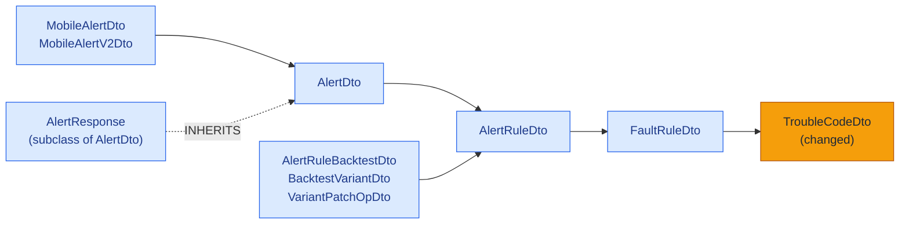

# "I changed `TroubleCodeDto`. What else must change?"

> **Scenario:** the FleetHd platform has about 280 C# repositories. `TroubleCodeDto` is a small DTO in
> `fleet-hd-contracts`, nested deep inside other DTOs. You renamed a field, changed a type, or changed the matching
> rules. Before the change is safe, you must know which code depends on it.
>
> Text search cannot answer this, and a one-hop graph query answers only part of it. Most of the impact is
> transitive: it reaches code that never names `TroubleCodeDto`. The codebase-memory-mcp graph follows the
> dependency edges, because the FleetHd fork records C# type references from properties, fields and method bodies.

All graph numbers below come from a full index of the monolith on 2026-10-24 (binary `0.12.1-fleethd.1`, worktrees
excluded). The grep numbers are from 2026-05-27.

---

## Why this type is the hard case

`fleet-hd-contracts/src/FleetHd.Contracts/AlertRule/Dto/TroubleCodeDto.cs:5`

```csharp
public class TroubleCodeDto : ICloneable
{
    public string FaultCodeId { get; set; }
    public string Protocol { get; set; }
    public int SourceAddress { get; set; }
    public int FaultCode { get; set; }
    public int FailureCode { get; set; }
    public string FaultType { get; set; }
    public string GroupId { get; set; }
    public int FaultCount { get; set; }
    public TimeSpan Window { get; set; }

    public virtual object Clone() => this.MemberwiseClone();
}
```

`TroubleCodeDto` is a leaf: every field is a primitive, so its own file tells you nothing about its dependents.
Other DTOs contain it. `FaultRuleDto` holds `ICollection<TroubleCodeDto>`, `AlertRuleDto` holds
`ICollection<FaultRuleDto>`, and `AlertDto` holds an `AlertRuleDto`. The containment closure is not one chain: it
has **17 types**.



The other types in the closure are `FaultRuleResultDto` and the `Null…` variants (`NullTroubleCodeDto`,
`NullFaultRuleDto`, `NullAlertRuleDto`, `NullAlertDto`, `NullAlertRuleBacktestDto`).

---

## What text search gives you

```text
$ grep -rn "TroubleCodeDto" C:\Users\Max\source\repos
… 219 matches across 36 files …
```

The 219 matches are mostly not the answer: a product PRD, two wiki pages, a README, a planning document, seed data
and many test fixtures. Grep finds only the string. A web-api endpoint that returns an `AlertRuleDto` does not
contain the text `TroubleCodeDto`, so grep returns none of those endpoints. To find them by hand, you must
discover each container type, search for it, and repeat for all 17 types.

---

## What the graph gives you

### Step 1: direct dependents

```cypher
MATCH (b {name:'TroubleCodeDto'})<-[:USAGE]-(a) RETURN count(a)                                   --> 170
MATCH (b {name:'TroubleCodeDto'})<-[:USAGE]-(a) WHERE NOT (a.file_path CONTAINS 'Test') RETURN count(a)  --> 31
```

The 31 production dependents name the type directly: the MongoDB projectors (the `Dto ↔ Entity` mapping) and
the fault-matching logic in `AlertRuleHelper`.

### Step 2: the containment closure

Find the types that hold a closure type, until no new type appears. Add a hop for subclasses (`INHERITS`):

```cypher
MATCH (t {name:'TroubleCodeDto'})<-[:USAGE]-(c:Class) WHERE c.name ENDS WITH 'Dto' RETURN DISTINCT c.name
MATCH (t {name:'AlertDto'})<-[:INHERITS]-(s) RETURN s.name, s.file_path
```

| Type | All dependents | Production dependents |
|---|---:|---:|
| `TroubleCodeDto` | 170 | 31 |
| `FaultRuleDto` | 186 | 41 |
| `AlertRuleDto` | 333 | 104 |

### Step 3: the affected endpoints

The graph has a `Route` node for each ASP.NET Core route and a `HANDLES` edge from the controller method. An
affected endpoint is a route handler that names a closure type:

```cypher
MATCH (t {name:'AlertRuleDto'})<-[:USAGE]-(m)-[:HANDLES]->(r:Route)
WHERE NOT (m.file_path CONTAINS 'Test')
RETURN DISTINCT r.name, m.name, m.file_path
```

Run it for each of the 17 types. Measured against a source scan of all `[Http*]` methods in fleet-hd-web-api and
fleet-hd-mobile-api:

| | Endpoints |
|---|---:|
| Source scan (methods whose attributes, signature or body name a closure type) | 34 |
| Graph, direct `USAGE` | 33 (all 33 are in the scan) |
| Graph, plus one `CALLS` hop to a helper that names a closure type | 44 |

The one endpoint that the graph does not find, `TruckContextQueryController.GetByVinAsync`, names `AlertDto` only on
master. The index reads each repo's working tree, and the fleet-hd-mobile-api checkout is on a branch without that
code. The `CALLS` hop adds 11 endpoints that the source scan cannot see, because a private helper names the type.
For example, `WorkflowStatusCommandController.SaveAsync` and `UpsertAsync` call `UpdateReferences`, which names
`NullAlertDto`:

```cypher
MATCH (t {name:'NullAlertDto'})<-[:USAGE]-(h)<-[:CALLS]-(m)-[:HANDLES]->(r:Route)
RETURN DISTINCT r.name, m.name, h.name
```

---

## Side by side

| | `grep` / text search | codebase-memory-mcp graph |
|---|---|---|
| Direct dependents of `TroubleCodeDto` | 219 matches in 36 files, unranked | 170 (31 production), with paths |
| Transitive dependents (17 container types) | not findable: the affected files do not contain the string | found by following `USAGE` and `INHERITS` |
| Affected endpoints | 0 | 33 of 34, plus 11 through helpers |
| Generic type arguments (`ICollection<TroubleCodeDto>`) | must be read by hand | extracted |
| Production versus test code | mixed | split by `NOT (file_path CONTAINS 'Test')` |

---

## Why this works

Stock extraction records type references only from function signatures. C# DTOs name their dependencies in
properties and fields (`ICollection<TroubleCodeDto>`) and in method bodies, so stock upstream has no
`AlertRuleDto —USAGE→ FaultRuleDto` edge. The FleetHd patches add these edges, send each C# reference to the type
that the file can see (its namespace, `using` directives and qualifiers), and type calls through fields. See
`docs/LOCAL_PATCHES.md`.

| Edge pattern (C# sources) | Count |
|---|---:|
| `Class —USAGE→ Class` (property and field types) | 6,166 |
| `Method —USAGE→ Class` (signatures and method bodies) | 60,471 |
| All `USAGE` edges (all languages) | 459,347 |

Run the queries through the `query_graph` MCP tool with `project="C-Users-Max-source-repos"`. Put the named node
first: the engine starts its scan there, and a pattern that starts from an anonymous node stops at the 30 s limit.
